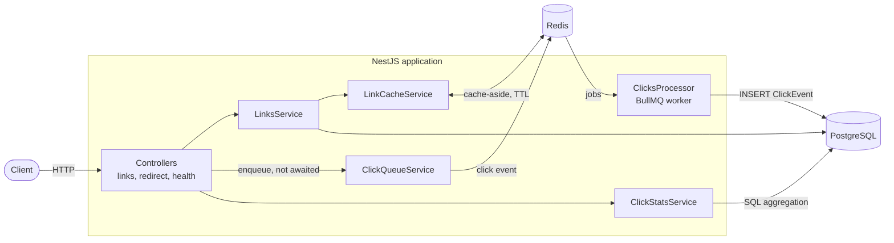
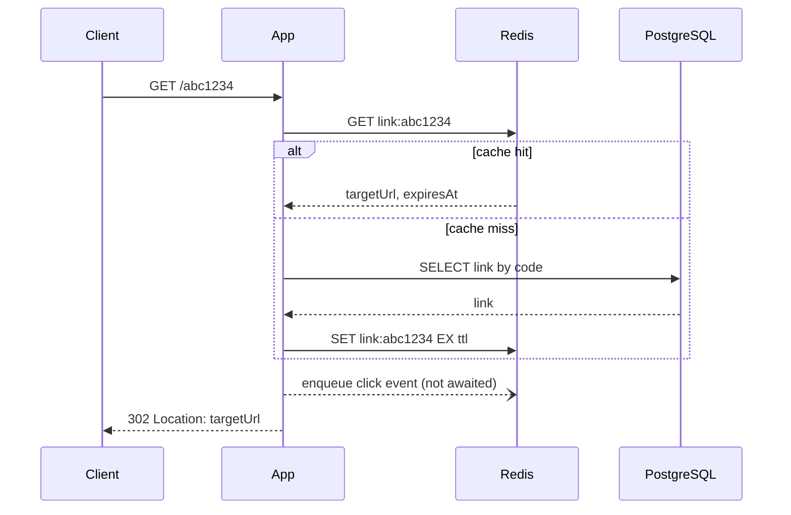

# Snip

<p>
  <a href="https://github.com/m-honcharenko/snip/actions/workflows/ci.yml"></a>
  <a href="https://github.com/m-honcharenko/snip/commits/main"></a>
  
  
</p>

<p>
  
  
  
  
  
  
  
  
  
  
  
  
  
</p>

A URL shortener with click analytics, built with NestJS and TypeScript. The focus is the backend: a fast redirect path (Redis cache), asynchronous analytics (BullMQ), SQL-aggregated statistics, input validation, rate limiting and a test suite that runs against real Postgres and Redis.

## Features

- Create short links (optional expiration date), list them with pagination, read metadata, delete.
- `302` redirects served from a Redis cache, with a database fallback.
- Click analytics recorded asynchronously: totals, clicks per day and top referrers per link.
- Strict input validation (zod) and one consistent JSON error format.
- Rate limiting on link creation (Redis-backed).
- OpenAPI documentation (Swagger UI) generated from the code.
- Multi-stage Docker image and a one-command Docker Compose setup.
- 72 unit tests and 28 end-to-end tests; CI runs both and smoke-tests the Docker stack.

## Quick start

```bash
git clone https://github.com/m-honcharenko/snip.git
cd snip
docker compose up --build
```

This starts PostgreSQL, Redis, applies the migrations and runs the app on <http://localhost:3000>. No `.env` file is needed: every variable has a default (the IP-hash secret default is a demo value, set your own `IP_HASH_SECRET` in `.env` for anything beyond a local run).

- Swagger UI: <http://localhost:3000/api>
- Health check: <http://localhost:3000/health>

```bash
# create a link
curl -s -X POST localhost:3000/links \
  -H 'content-type: application/json' \
  -d '{"url":"https://example.com/some/long/path"}'
# {"code":"aB3dE9k","targetUrl":"https://example.com/some/long/path","expiresAt":null,"createdAt":"..."}

# follow it
curl -i localhost:3000/aB3dE9k
# HTTP/1.1 302 Found
# Location: https://example.com/some/long/path

# statistics (last 30 days by default)
curl -s localhost:3000/links/aB3dE9k/stats
```

If ports `3000`, `5432` or `6379` are taken, set `APP_PORT`, `POSTGRES_PORT` or `REDIS_PORT` in `.env`.

## API

| Method and path          | Description                                                                                              |
| ------------------------ | -------------------------------------------------------------------------------------------------------- |
| `POST /links`            | Create a link (`url`, optional `expiresAt`). Rate limited: 10 per minute per IP.                         |
| `GET /:code`             | `302` redirect. `404` for an unknown code, `410` for an expired link.                                    |
| `GET /links`             | List links, newest first. `page` (default 1) and `limit` (1 to 100, default 20).                         |
| `GET /links/:code`       | Link metadata (expired links are returned too).                                                          |
| `GET /links/:code/stats` | Total clicks, clicks per day and top referrers. `days` (1 to 365, default 30).                           |
| `DELETE /links/:code`    | Delete a link (`204`) and drop it from the cache.                                                        |
| `GET /health`            | `200` if the database is up; `status` is `degraded` when Redis is down, `503` when the database is down. |

All errors share one shape:

```json
{
  "statusCode": 400,
  "error": "Bad Request",
  "message": "Validation failed",
  "details": ["url: Invalid URL"],
  "path": "/links"
}
```

`details` is present only for validation errors. Unexpected errors return a generic `500` message; the details stay in the server log.

A [Posting](https://posting.sh) request collection lives in [`requests/`](requests). Install Posting (`uv tool install posting`) and run `pnpm requests`. Run "Create link" first: a post-response script stores the new code, and the other requests use it.

> **Posting version.** The collection and its Python script (`requests/scripts/save_code.py`) target Posting 2.x, the Python/Textual version. The latest release is 2.11.2, and the script is compatible up to that version. Posting 3 is a beta rewrite in Go. It opens the same collections, but [it does not run Python scripts](https://posting.sh/guide/migrating/) (they stay in the request files untouched), so the `last_code` auto-save does not work there. In Posting 3 copy the code from the "Create link" response by hand, or replace the script with a response capture or a session value. Both versions install a `posting` command, so if you have both, check which one is first in your `PATH`.

## Architecture



The redirect hot path:



## Design decisions and trade-offs

**Short codes: random nanoid, not base62 of the row ID.** A code is 7 characters from a 62-character alphabet (about 3.5 trillion combinations). Random codes can't be enumerated by incrementing a number and can be generated before the `INSERT`. A collision is possible but rare; the unique index on `Link.code` catches it and the service retries with a new code (up to 5 times). The alphabet is covered by a test that checks every generated code passes the route's code validation.

**Redirect cache: cache-aside in Redis.** Key `link:<code>`, TTL is the smaller of one hour and the time left until `expiresAt`, so an expired link leaves the cache exactly when it expires. Unknown codes and expired links are not cached. Deleting a link removes its key. Every Redis call is wrapped: if Redis fails, the error is logged and the request falls through to the database, so a cache outage costs speed, not availability.

**`302`, not `301`.** Browsers cache a `301` permanently, which would hide repeat clicks from the analytics and make it impossible to disable or expire a link.

**Click analytics are asynchronous and best-effort.** A redirect enqueues a BullMQ job without awaiting it; a worker writes the `ClickEvent` row. The worker retries a job 5 times with exponential backoff (about 15 seconds in total). Delivery is at-least-once (a rare crash between the database write and the acknowledgement can record a click twice) and the enqueue itself is best-effort (if Redis is down at that moment the click is dropped). Only successful redirects record a click.

**Privacy: the client IP is never stored in clear text.** Only an HMAC-SHA256 of the IP with a server-side secret (`IP_HASH_SECRET`) is kept. A plain hash of an IPv4 address can be brute-forced in seconds; a keyed one can't. Referrer and user agent are truncated to 512 characters, and the stats group referrers by host.

**Statistics aggregate in SQL.** `GROUP BY` runs in PostgreSQL over the `(linkId, clickedAt)` index, and only finished rows reach the app. The days without clicks are filled in code (a small pure function with its own tests), because that is presentation, not aggregation.

**URL policy.** Only `http` and `https`, at most 2048 characters, no credentials in the URL, no `localhost` or `*.localhost`/`*.local`/`*.internal` names, no single-label hosts, and no private, loopback, link-local, CGNAT, multicast or reserved IP addresses (IPv4 and IPv6, including IPv4-mapped). The service never fetches a stored URL, it only redirects the visitor's browser, so the goal is to stop links that send people to internal addresses. DNS is not resolved: a public domain that points to a private address is accepted. If link previews or any server-side fetching are added, an SSRF defence that checks the resolved IP at connection time becomes necessary.

**Rate limiting is fail-open too.** `POST /links` allows 10 requests per minute per IP, counted in Redis. If Redis is unavailable the limiter lets the request through and logs a warning instead of turning link creation into a `500`.

**Validation with zod and a single error filter.** Request bodies, query strings and the `:code` path parameter are validated by schemas; a global exception filter turns every error (validation, `404`, `410`, `429`, malformed JSON, unexpected) into the same JSON shape. A malformed code on the public redirect answers `404` without touching Redis or the database.

**Offset pagination.** `page` and `limit` with a total count: simple and enough here. It gets slow on very large tables and pages can shift while rows are added; a cursor on `(createdAt, id)` would be the next step.

**Migrations run as a separate one-shot container.** The runtime image contains production dependencies only (no Prisma CLI, no dev tooling) and runs as a non-root user. The `migrate` service uses the full dependency stage, applies pending migrations and exits; the app waits for it to finish.

## Performance

`pnpm bench` builds the app, runs it in production mode and load-tests `GET /:code` with [autocannon](https://github.com/mcollina/autocannon) in three scenarios. Two switches make the comparison possible: `LINK_CACHE_ENABLED` and `CLICK_TRACKING_ENABLED` (both on by default). The benchmark uses the test database and Redis db 1 and cleans them before and after each scenario.

| Scenario                          | req/s | p50 ms | p97.5 ms | p99 ms |  vs A |
| --------------------------------- | ----: | -----: | -------: | -----: | ----: |
| A: no cache, no click tracking    | 16289 |      2 |        3 |      4 | x1.00 |
| B: Redis cache                    | 50864 |      0 |        1 |      1 | x3.12 |
| C: Redis cache and click tracking | 24681 |      1 |        2 |      3 | x1.52 |

50 connections, 10 s per scenario, 3 s warm-up, run on a laptop with the load generator, the server, PostgreSQL and Redis on the same machine. Across four runs the cache gave 2.9x to 3.4x over the database and click tracking kept 1.4x to 1.8x. Compare the rows, not the absolute numbers: the database is local, so the real gap to a networked database would be larger. Even a fire-and-forget click costs about half of the cache gain (an HMAC, a few Redis commands per click, and the worker sharing a process with the HTTP handler); moving the worker to its own process would remove most of that.

## Known limitations

- There is no authentication: anyone who knows a code can delete the link. Ownership (JWT) is the natural next feature.
- Click events are dropped if Redis is down when the redirect happens; jobs that fail 5 times stay in the BullMQ failed set for 7 days.
- A cached link can be served for up to an hour after deletion in one rare race (a redirect reads the row just before the delete and writes the cache just after the invalidation).
- The URL policy does not resolve DNS (see above).
- The worker runs inside the API process; at higher load it should be a separate process or service.
- A single instance: nothing here has been tested behind a load balancer.

## Development

Requirements: Node.js 26, pnpm 12, Docker.

```bash
cp .env.template .env            # then set IP_HASH_SECRET
docker compose up -d db redis    # only the infrastructure
pnpm install
pnpm prisma generate
pnpm prisma migrate dev
pnpm start:dev                   # http://localhost:3000
```

| Command                          | What it does                                                            |
| -------------------------------- | ----------------------------------------------------------------------- |
| `pnpm test`                      | Unit tests (Prisma and the cache are stubbed)                           |
| `pnpm test:e2e`                  | End-to-end tests against real PostgreSQL (`snip_test`) and Redis (db 1) |
| `pnpm test:cov`                  | Unit tests with coverage                                                |
| `pnpm lint`, `pnpm format:check` | oxlint (type-aware) and oxfmt                                           |
| `pnpm build`                     | Compile to `dist/`                                                      |
| `pnpm bench`                     | Redirect benchmark                                                      |
| `pnpm requests`                  | Open the Posting request collection (needs Posting installed)           |

The e2e setup creates the `snip_test` database, applies the migrations, and refuses to run against any other database. In development (outside production) a read-only Bull Board for the click queue is available at `/admin/queues`.

### Configuration

| Variable                 | Default       | Description                                            |
| ------------------------ | ------------- | ------------------------------------------------------ |
| `DATABASE_URL`           | none          | PostgreSQL connection string                           |
| `REDIS_URL`              | none          | Redis connection string                                |
| `IP_HASH_SECRET`         | none          | Secret for hashing client IPs (16+ characters)         |
| `PORT`                   | `3000`        | HTTP port                                              |
| `NODE_ENV`               | `development` | `production` disables Bull Board                       |
| `LINK_CACHE_ENABLED`     | `true`        | Set to `false` to skip the redirect cache (benchmarks) |
| `CLICK_TRACKING_ENABLED` | `true`        | Set to `false` to skip recording clicks (benchmarks)   |

### Project layout

```text
src/
  analytics/   click queue, BullMQ worker, statistics
  common/      global exception filter
  config/      environment schema (zod)
  health/      health check
  links/       controllers, service, cache, validation, URL policy
  prisma/      database client
  redis/       Redis client
prisma/        schema and migrations
test/          end-to-end tests and test support
scripts/       benchmark
requests/      Posting request collection
```

## Tech stack

Node.js 26, NestJS 12 (ESM), TypeScript 6, PostgreSQL 16 with Prisma 7, Redis 7 with ioredis, BullMQ 6, zod 4, `@nestjs/throttler`, `@nestjs/swagger`, Vitest 5 and Supertest, oxlint and oxfmt, pnpm 12, Docker and GitHub Actions.
